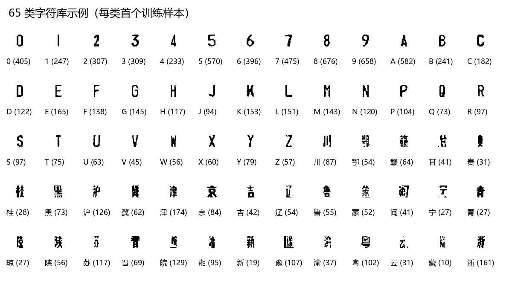
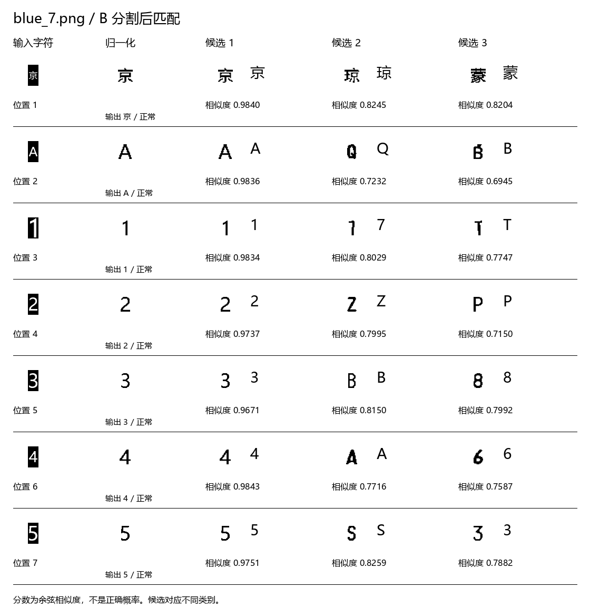
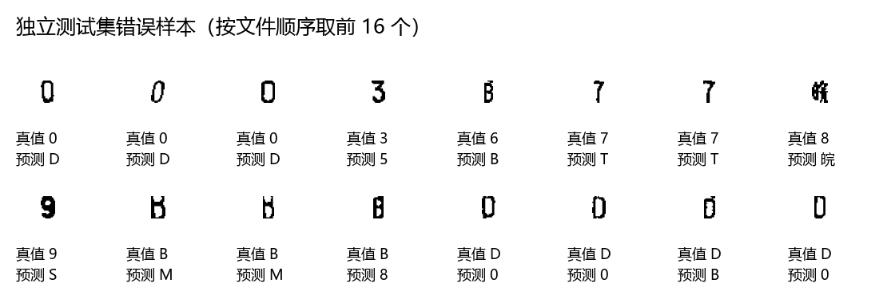

# 车牌识别系统 C 部分：字符库与匹配识别

## 一、任务和实现范围

本模块接收 B 输出的从左到右字符切片，完成字符特征提取、样本库匹配、逐字候选输出与号码拼接。
提供独立命令行、Python 接口、样本库构建程序、匹配过程可视化、独立字符评估和 B 联调示例。
检测定位与矫正属于 A，颜色和切字属于 B，GUI、exe 与系统集成属于 D，整体验收及报告整合属于 E。

## 二、数据和来源

数据来自 [License-Plate-Recognition](https://github.com/wzh191920/License-Plate-Recognition)，固定提交
`34ba808ea2563b3b2ff7266b9cc6d0d9a98f52b1` 中 chars2.7z、charsChinese.7z。上游说明数据来源于 EasyPR。
保留下载地址、文件大小、git blob SHA1、SHA256、源 README、MIT 及 EasyPR Apache 许可证。
原始支持类别图片 16395 张；归一化像素 SHA256 去重 3334 张，
跨标签冲突排除 15 张，保留 13046 张。
invalid 为 0。排除明细在 third_party/excluded_samples.json。

采用随机种子 20261116，按类别约 70%/15%/15% 划分，训练 9130、
验证 1958、测试 1958 张；归一化去重在划分之前完成。
共 65 类，类别不均衡；藏仅 6 张独立图，其中公开训练 4、验证 1、测试 1。
上游 zh_qing 使用异体“靑”，本实现统一输出规范字“青”。
为适配屏幕字体输入，额外独立渲染全部 65 类的辅助模板 387 张，
字体为微软雅黑/黑体、字号 48/64/80。未用 B 切片作训练，字体二进制不随包分发。
最终训练库共 9517 张。字体与公开评估图片没有归一化哈希交集。

## 三、算法

Otsu 二值化，按边界判断背景并统一极性，裁前景框，等比例缩放并居中放入 32×32。
保留所有汉字笔画，不只取最大连通域。提取 NumPy 实现的 324 维 Root-HOG，以及 1024 维单位像素向量。
两者以 sqrt(0.55)、sqrt(0.45) 缩放后拼接，得到 1348 维单位向量。
查询与样本的点积等价于 0.55×HOG 余弦 + 0.45×像素余弦；每类取最佳样本，再选择不同类别 Top3。

standard 模式首位限省份、第二位限字母、后续限数字/字母，接受 7/8 位；不是完整号牌规则校验。
默认相似度低于 0.75 或前两类差值小于 0.02 时建议复核，阈值是启发式，分数不是正确概率。
坏切片保留 ?，数量异常返回空号码及状态，避免静默补字。

## 四、验证集选择与对照

在公开训练库上，仅用 validation 比较像素权重 0/0.15/0.30/0.45/0.60，
Top1 依次为 91.73%/95.61%/96.78%/96.88%/96.53%，取 0.45。
之后因 B 合成字体失配，新增对全部类别统一生成的字体模板；保留补充前后结果。
最终 validation Top1 为 96.88%。
最初 HOG 基线测试结果曾被查看，后续选择权重使用 validation；因此这是开发留出集结果，
不是一次性盲测。正式结论还需新增未参与开发的真实外部数据。

| 方案 | 留出测试 Top1 | 结果目录 |
|---|---|---|
| 仅 Root-HOG，公开训练库 | 91.83% | results/baseline_hog_test |
| HOG+像素，公开训练库 | 97.40% | results/real_library_test |
| HOG+像素，公开训练+字体模板 | 97.45% | results/test |

compare_features.py 可复现权重比较。基线和中间失败结果均保留，未只保留最好的输出。

## 五、最终单字符测试

| 类别 | 数量 | 无类别约束 Top1 | 无类别约束 Top3 |
|---|---:|---:|---:|
| 全部 | 1958 | 97.45% | 99.03% |
| 数字 | 902 | 99.00% | 99.78% |
| 字母 | 646 | 98.14% | 99.85% |
| 省份汉字 | 410 | 92.93% | 96.10% |

Top1 共 1908/1958，宏平均类别召回率 94.05%。
知道首位为省份、其余为字母数字的类型约束下，Top1 为 97.65%，
Top3 为 99.13%；此实验没有额外使用“第二位只限字母”的更强约束。
无约束结果中 154 张建议复核，自动接受 1804 张中仍有
7 张错误，说明 ok 不是正确性保证。
批量 128 测试时，含读图/预处理的平均单字耗时约
1.05 ms，属于本机批量测量，不能视为 GUI 单字延迟承诺。
逐图结果、每类召回和完整混淆矩阵分别见 predictions.csv、per_class.csv、confusion_matrix.csv。

## 六、B -> C 实际联调

B 原始代码与样例原样保存在 integration/B_original。重新运行颜色与切字后，
六组切片与原包存档逐像素一致。B 输出为 40×20 灰度白字黑底，可直接进入 C。

| 样例 | 真值 | 切片数 | 输出 | C 状态 |
|---|---|---:|---|---|
| black_7.png | 浙FA1B2C | 7 | 浙FA1B2C | ok |
| blue_7.png | 京A12345 | 7 | 京A12345 | ok |
| blue_tilt.png | 冀D97531 | 5 | 不输出号码 | invalid_length |
| green_8.png | 粤CD12345 | 8 | 粤CD12345 | ok |
| white_7.png | 苏E66T78 | 7 | 苏E66T78 | ok |
| yellow_7.png | 沪B88888 | 7 | 沪B88888 | ok |

六张中五张完整识别，五张分割正常图全部完整匹配；倾斜图只切出 5 字，拒绝拼成常规车牌。
未补字体模板时只有 1/6 完全正确，旧结果保存在 results/real_library_B_integration，说明字体覆盖的重要性。
这些图和辅助模板使用同字体家族，因此只能证明该合成输入与接口兼容，不能证明真实整牌泛化。

## 七、失败案例与局限

同形字符 D/0、7/T、B/M 与低分辨率汉字仍会混淆；部分公开样本本身有噪点、断笔或裁切损失。
Top3 展示了其他候选，人工复核可参考原始切片与最佳模板，但不能仅靠分数判真伪。
同源随机划分只排除了完全相同的归一化图，仍可能存在近重复和共同原始车牌。
稀有类数量少、特殊字符未支持、上游切割错误及严重透视反光等仍需后续解决。
当前没有 A 的新真实图、完整 GUI、exe 和无 Python 机器验收，不能声称完成整个小组系统。

## 八、可复现性与贡献

环境：Python 3.13.7、OpenCV 5.0.0、NumPy 2.3.5、
Pillow 12.0.0，CPU 运行。17 项行为检查通过，包含中文路径、极性、输入格式、
坏字符位置、7/8 位、Top3 类别去重、独立距离核验、全量哈希与划分隔离、构库冲突检测、B 像素复现及 CLI 退出码。
ZIP 解压后的离线识别、重新构库和结果一致性验收见 acceptance_record.json。
C 的工作为样本来源与去重、特征实现、样本库、匹配接口、异常/复核、可视化、评估与文档。
没有新增系统依赖，requirements.txt 记录运行所需三项包；PDF 工具复用已有 ReportLab。

## 九、来源

- [公开字符集及源代码仓库](https://github.com/wzh191920/License-Plate-Recognition/tree/34ba808ea2563b3b2ff7266b9cc6d0d9a98f52b1)
- [EasyPR](https://github.com/liuruoze/EasyPR/tree/c32d69c50439f02b3ab9b4230048b2895d876d16)
- 用户提供 B模块_颜色识别与字符分割.zip；SHA256：991805eaa12565ef4f9875b5a7b336128b1e8ad7f9c77b40501cce825957482f。
- 算法与评估说明对应当前代码，字体模板为本次独立生成，未宣称公开原始样本由本组采集。
